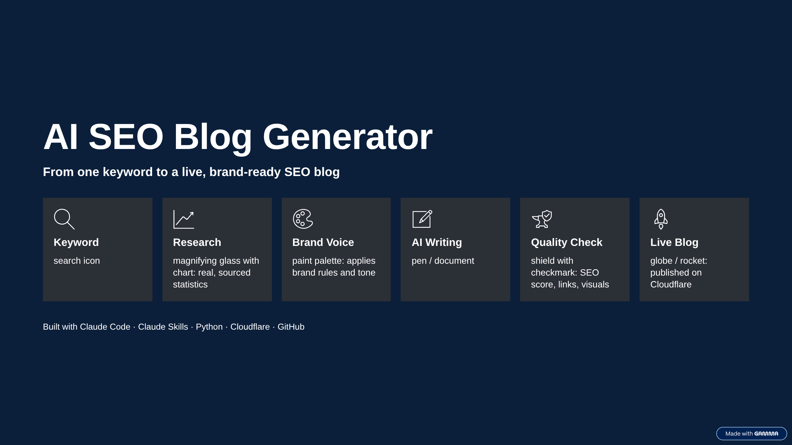

# AI SEO Blog Generator

<p align="center">
  
</p>

**From one keyword to a live, brand-ready SEO blog.**

Type a keyword, and this project researches the topic, writes a full blog post in the brand's own voice, checks it for SEO and quality, renders it as a web page, and deploys it live on Cloudflare.

I built it with AI-assisted development (Claude Code) on top of the open-source [claude-blog](https://github.com/AgriciDaniel/claude-blog) skill suite, then customized it for two real education brands.

## Demo Video

[Watch the demo video (3 min)](assets/demo/demo.mp4): the blog post for the keyword "best country to study nursing abroad" being generated in Claude Code, then the finished post opened in the browser.

## Live Blogs Generated With This Project

| Blog | Brand | Live link |
|---|---|---|
| Best Country to Study Nursing Abroad in 2026: A Guide for Indian Nurses | Jusst Nursing | [View blog](https://jusst-nursing-best-country.tarannum.workers.dev) |
| Study Nursing Abroad: What It Actually Pays Off in 2026 | Jusst Nursing | [View blog](https://jusst-nursing-study-abroad.pages.dev) |
| Global Academic Success: What Admission Doesn't Guarantee | Uniassure | [View blog](https://uniassure-global-academic-success.pages.dev) |

The source files for each post (Markdown, HTML, preview screenshots, and quality reports) are in [`drafts/`](drafts/).

## How It Works

| Step | What happens |
|---|---|
| 1. Keyword | You run `/blog write <keyword>` in Claude Code. |
| 2. Research | The AI finds current statistics from official sources (government, regulators, research bodies) and records each source link. |
| 3. Brand Voice | The brand's rules from `BRAND.md` and `VOICE.md` are loaded: audience, tone, banned phrases, and formatting rules. |
| 4. AI Writing | A full post is written from a matching template, with Key Takeaways, charts, comparison tables, an FAQ, and inline citations. |
| 5. Quality Check | A 5-gate check verifies all files exist, the page renders correctly on mobile, tablet, and desktop, the content is scored against a 100-point rubric, and every link and image works. |
| 6. Live Blog | The post is rendered to HTML and PDF with SEO metadata and structured data, then deployed on Cloudflare. |

## What I Built and Customized

The base engine comes from the open-source claude-blog project. My work on top of it:

**Brand voice profiles**
- Wrote brand and voice guideline files for two brands: Jusst Nursing (`BRAND.md`, `VOICE.md`) and Uniassure (`BRAND.uniassure.md`, `VOICE.uniassure.md`).
- Each profile defines the audience, positioning, tone, sentence length limits, readability targets, topic scope, and a list of banned AI-sounding phrases. Every post follows these rules automatically.

**Code improvements** (Python, in `scripts/`)
- `blog_render.py`: added heading anchors so the table of contents links work, generated FAQPage structured data (JSON-LD) from the FAQ section, fixed SVG charts that broke the page layout, fixed parsing of inline tag lists, and made file reading work on Windows.
- `generate_hero.py`: updated the Openverse image API address, added fallback searches when the first image search returns nothing, and fixed the file type for AI-generated images.

**Repository and deployment**
- Fixed the GitHub Actions CI so all automated checks pass on this repository.
- Generated three blog posts and deployed them on Cloudflare. The deploy bundle for the newest post is in [`deploy/`](deploy/).

## Tech Stack

- **Claude Code**: AI-assisted development and the runtime for the blog skills
- **Claude Skills and agents**: researcher, writer, SEO checker, and reviewer
- **Python**: rendering, quality scoring, image sourcing, and preflight checks
- **Playwright (patchright)**: PDF export and screenshots at three screen sizes
- **SEO**: meta tags, Open Graph, BlogPosting and FAQPage JSON-LD
- **Cloudflare Pages / Workers**: hosting
- **GitHub Actions**: automated tests and checks

## Project Structure

```
BRAND.md, VOICE.md        Active brand profile (Jusst Nursing)
BRAND.uniassure.md, ...   Second brand profile (Uniassure)
skills/                   Blog skills: write, rewrite, analyze, schema, and more
agents/                   Researcher, writer, SEO, reviewer, and translator agents
scripts/                  Python tools: render, score, preflight, hero image
drafts/                   Generated blog posts with HTML, screenshots, and reports
deploy/                   Cloudflare deploy bundle
tests/                    Automated tests
```

## How to Run It

1. Install the Python dependencies:

   ```bash
   pip install -r requirements.txt markdown pillow patchright
   python -m patchright install chromium
   ```

2. Add the project as a Claude Code plugin (run inside Claude Code):

   ```
   /plugin marketplace add <path-to-this-folder>
   /plugin install claude-blog@agricidaniel-blog
   ```

3. Pick a brand. `BRAND.md` and `VOICE.md` are the active profile. To switch to Uniassure, copy `BRAND.uniassure.md` to `BRAND.md` and `VOICE.uniassure.md` to `VOICE.md`.

4. Start Claude Code in this folder and write a post:

   ```
   /blog write best country to study nursing abroad
   ```

5. Deploy the finished post. Copy the HTML (as `index.html`) and its images into a folder, then run `npx wrangler deploy` from there.

## Credits and License

This project is built on [claude-blog](https://github.com/AgriciDaniel/claude-blog) by AgriciDaniel, released under the MIT License. The original license and notice are kept in [`LICENSE`](LICENSE) and [`NOTICE`](NOTICE). The brand profiles, code changes listed above, and generated blog posts are my additions.

Blog images are credited in each post's `hero-credit.txt` and `images/*-credit.txt` files.
