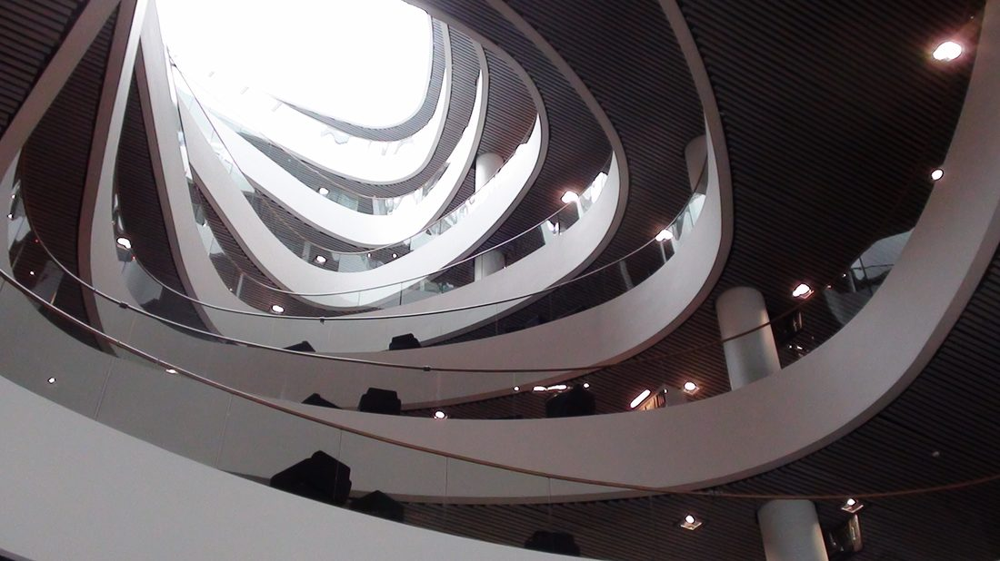
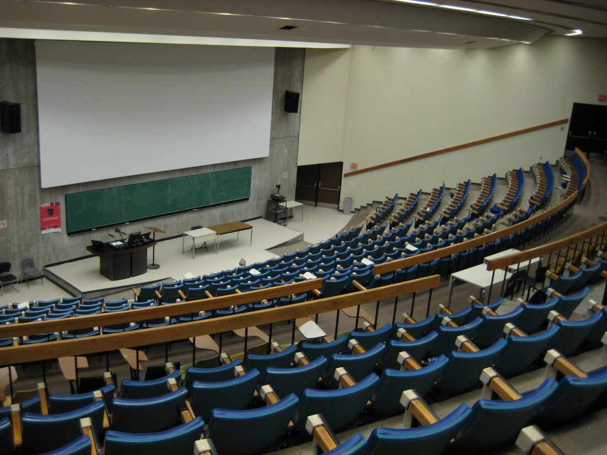
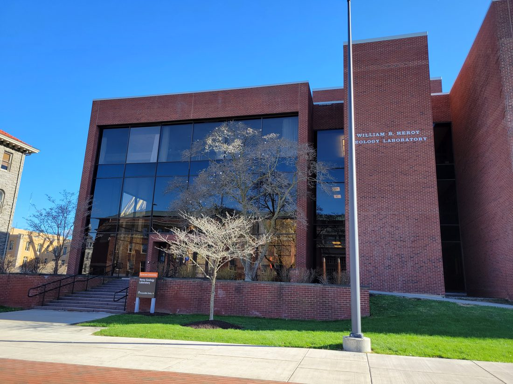

# Global Academic Success: What Admission Doesn't Guarantee

> **Key Takeaways**
> - Cultural and academic adaptation, not admission strength, is the strongest predictor of how international students perform once classes start. Social integration alone accounts for 64% of that effect (Journal of International Students, 2026, retrieved 2026-08-24).
> - Roughly 23% of international students report dissatisfaction with the shift to a new teaching style after arrival (DAAD, 2025), a gap that shows up as grades, not just discomfort.
> - Repeating a semester abroad after an academic setback costs INR 15-25 lakh in tuition, fees, and living expenses, on top of the original investment.
> - As of 2025, researchers still describe a shortage of published, data-informed frameworks for international student academic success, meaning most students are navigating this transition with no structured playbook at all.
> - Readiness-first preparation, built around pedagogical alignment before departure, is what closes the gap between getting admitted and actually succeeding.

Global academic success is not the same achievement as getting admitted. Higher education has never been more global. Enrollment worldwide has reached 264 million students. 6.9 million of them study outside their home country ([OECD, International Students in Higher Education](https://www.oecd.org/en/publications/international-students-in-higher-education_005ff28d-en/full-report/study-adaptation-progression-and-success_6867398c.html), retrieved 2026-08-24). Every one of those 6.9 million students already cleared the admissions bar. What separates the ones who thrive from the ones who struggle happens after the offer letter. It happens inside classrooms built on teaching and assessment norms most students have never encountered.

This guide covers what the research actually says about global academic success. It covers what predicts success, where students get blindsided, what it costs to get wrong, and what a readiness-first approach looks like in practice.

## Table of Contents

- [What Global Academic Success Actually Means](#what-global-academic-success-actually-means)
- [Why Admission Doesn't Guarantee It: The Learning Shock Problem](#why-admission-doesnt-guarantee-it-the-learning-shock-problem)
- [The Pedagogical Gap: How Teaching and Assessment Differ by Destination](#the-pedagogical-gap-how-teaching-and-assessment-differ-by-destination)
- [The Real Cost of Getting This Wrong](#the-real-cost-of-getting-this-wrong)
- [What Actually Works: Evidence From Structured Readiness Programs](#what-actually-works-evidence-from-structured-readiness-programs)
- [Building a Readiness-First Pathway](#building-a-readiness-first-pathway)
- [Frequently Asked Questions](#frequently-asked-questions)

## What Global Academic Success Actually Means

**Global academic success** is a student's ability to perform at the same standard abroad that they showed at home. It is measured by grades, degree completion, and progress, not by the admission decision that got them there. It is a different outcome from admission success, which only measures whether a student was accepted.

The two get conflated constantly. A university offer confirms that a student's prior academic record met a threshold. It says nothing about whether that student can operate inside a new academic culture. Classroom norms differ. Assessment weighting differs. Expectations for independent work differ. For a closer look at how students actually prepare for that shift, see [Uniassure's guide to international pathway programs](https://asbuniassure.com/blogs/international-pathway-program-how-students-prepare-university-abroad).

Three components determine global academic success in practice:

- **Pedagogical alignment**: whether a student already understands how teaching, discussion, and independent research work in the destination system
- **Assessment literacy**: whether a student knows how grades are actually built, exams, coursework, participation, in the destination country
- **Social integration**: whether a student builds the peer and academic support network that mediates stress and disorientation

Cultural adaptation significantly predicts academic performance. Social integration mediates 64% of that effect, according to a study of international students in Beijing ([Journal of International Students](https://www.ojed.org/jis/article/view/9014), retrieved 2026-08-24). Academic performance abroad is substantially a function of how well a student adapts, not how well they were prepared academically before leaving.

## Why Admission Doesn't Guarantee It: The Learning Shock Problem

The direct answer: admission tests whether a student's past academic record meets a bar. It does not test whether a student can function inside an unfamiliar teaching and assessment system. That is what determines performance after arrival.

Researchers call this disruption learning shock. **Learning shock** is confusion about the new academic system specifically, not the wider culture around it. A student in learning shock does not know what a professor actually wants. They cannot judge how much independent work is expected. They misjudge how grades are weighted. These sit on top of the more visible signs: homesickness and feeling left out. A 21-year review of this research found the same problems again and again. Language barriers. Unfamiliar academic rules. Weak support services ([Journal of International Students](https://journals.sagepub.com/doi/10.1177/21582440231210387), retrieved 2026-08-24).

<figure>
<svg viewBox="0 0 560 340" xmlns="http://www.w3.org/2000/svg" role="img" aria-labelledby="chart1-title chart1-desc">
<title id="chart1-title">What Predicts International Student Academic Performance</title>
<desc id="chart1-desc">Bar chart showing social integration accounts for 64 percent of the effect of cultural adaptation on academic performance, with the remaining 36 percent attributed to other factors.</desc>
<rect width="560" height="340" fill="#FFFDEE"/>
<text x="280" y="34" text-anchor="middle" font-family="Jost, sans-serif" font-size="18" font-weight="700" fill="#096B68">What Predicts Academic Performance Abroad</text>
<text x="280" y="56" text-anchor="middle" font-family="Jost, sans-serif" font-size="12" fill="#227B75">Share of the cultural-adaptation effect on academic performance</text>
<rect x="80" y="100" width="260" height="60" rx="6" fill="#096B68"/>
<text x="90" y="135" font-family="Jost, sans-serif" font-size="16" fill="#FFFFFF" font-weight="600">Social integration: 64%</text>
<rect x="80" y="175" width="146" height="60" rx="6" fill="#34C0B7"/>
<text x="90" y="210" font-family="Jost, sans-serif" font-size="16" fill="#0A1A2B" font-weight="600">Other factors: 36%</text>
<line x1="80" y1="270" x2="480" y2="270" stroke="#227B75" stroke-width="2"/>
<text x="80" y="295" font-family="Jost, sans-serif" font-size="11" fill="#0A1A2B">Source: Journal of International Students, 2026</text>
</svg>
<figcaption>Source: Journal of International Students, retrieved 2026-08-24.</figcaption>
</figure>

Here is the practical point. A readiness plan that only covers grades, test scores, or visa logistics misses the real predictors of term-time performance.

## The Pedagogical Gap: How Teaching and Assessment Differ by Destination

The direct answer: the UK, Australia, and the US weight assessment differently. A student calibrated to one system will misjudge how to allocate effort in another, unless prepared for the specific gap. Uniassure's own research into this gap for UK-bound students is covered in [the academic writing gap facing Indian scholars in UK universities](https://asbuniassure.com/blogs/academic-writing-gap-indian-scholars-uk-universities).

In the UK, final exams and dissertations carry most of the grade. Most marks land at the end of term. UK teaching also leans on independent thinking and open discussion in seminars. That can feel strange to a student used to a more structured, exam-only system. Australia works differently. It leans far more on continuous assessment. Assignments, quizzes, presentations, and class participation all add up across the term, not just at the end ([comparative analysis of UK and Australian education systems](https://www.myassignmenthelp.co.in/2026/06/11/key-differences-between-the-education-systems-in-the-uk-and-australia/), retrieved 2026-08-24).

This is not a small detail. A student who prepares for an exam-heavy system, then lands in a continuous-assessment one, will under-invest in early coursework. That is the work quietly building or wrecking their grade from week one. The opposite mismatch fails the opposite way: a student leans on participation and under-prepares for one high-stakes final.

The gap shows up in real numbers, not just stories. In Germany, 23% of international students said they struggled with the shift to German teaching methods (DAAD, 2025, retrieved 2026-08-24). Some international students in the UK also describe "digital shock": more reliance on unfamiliar digital tools than they expected, with little prior practice on them.

<figure>
<svg viewBox="0 0 560 320" xmlns="http://www.w3.org/2000/svg" role="img" aria-labelledby="chart2-title chart2-desc">
<title id="chart2-title">UK vs Australia Assessment Weighting</title>
<desc id="chart2-desc">Comparison chart showing the UK relies more heavily on final exams while Australia distributes grading across continuous assessment throughout the term.</desc>
<rect width="560" height="320" fill="#EAFFFE"/>
<text x="280" y="34" text-anchor="middle" font-family="Jost, sans-serif" font-size="18" font-weight="700" fill="#096B68">Assessment Style: UK vs Australia</text>
<text x="150" y="70" text-anchor="middle" font-family="Jost, sans-serif" font-size="14" font-weight="600" fill="#0A1A2B">United Kingdom</text>
<rect x="60" y="90" width="180" height="34" rx="4" fill="#096B68"/>
<text x="150" y="112" text-anchor="middle" font-family="Jost, sans-serif" font-size="12" fill="#FFFFFF">Final exams and dissertations</text>
<rect x="60" y="134" width="90" height="24" rx="4" fill="#34C0B7"/>
<text x="150" y="151" text-anchor="middle" font-family="Jost, sans-serif" font-size="11" fill="#0A1A2B">Coursework</text>
<text x="410" y="70" text-anchor="middle" font-family="Jost, sans-serif" font-size="14" font-weight="600" fill="#0A1A2B">Australia</text>
<rect x="320" y="90" width="90" height="34" rx="4" fill="#096B68"/>
<text x="365" y="112" text-anchor="middle" font-family="Jost, sans-serif" font-size="12" fill="#FFFFFF">Exams</text>
<rect x="320" y="134" width="180" height="24" rx="4" fill="#34C0B7"/>
<text x="410" y="151" text-anchor="middle" font-family="Jost, sans-serif" font-size="11" fill="#0A1A2B">Assignments, quizzes, presentations, participation</text>
<line x1="60" y1="190" x2="500" y2="190" stroke="#227B75" stroke-width="2"/>
<text x="60" y="215" font-family="Jost, sans-serif" font-size="11" fill="#0A1A2B">Source: UK/Australia education systems analysis, 2026</text>
</svg>
<figcaption>Source: myassignmenthelp.co.in comparative analysis, retrieved 2026-08-24.</figcaption>
</figure>

For the deeper mechanics of this specific gap, see [Uniassure's guide to the academic writing gap for Indian scholars in UK universities](https://asbuniassure.com/blogs/academic-writing-gap-indian-scholars-uk-universities).

## The Real Cost of Getting This Wrong

The direct answer: an academic setback abroad is not just a grade problem. It is a five-figure-dollar financial event layered on top of a transcript problem.

Say a student fails a required course, or falls far enough behind to need an extra term. The costs stack up fast. There is extra tuition for the retake. There is more rent, food, and transport for the extra months. Sometimes there is a visa extension too. Most universities keep the failed attempt on the transcript, even after a retake passes. That GPA hit can hurt a student's chances at postgraduate study or a competitive scholarship later ([overview of academic and financial consequences of failing coursework abroad](https://www.gatewayabroadeducations.com/article/failing-course-international-student-europe), retrieved 2026-08-24).

For Indian students, repeating one semester abroad typically costs INR 15-25 lakh. That figure covers tuition, fees, and living costs for the extra time. This is not the price of studying abroad. It is the price of studying abroad twice, for the same result. Readiness-focused preparation fixes academic gaps before the money is committed. That is what avoids this outcome. Done well, it can save roughly ₹20-22 lakh in tuition and living costs.

<figure>
<svg viewBox="0 0 560 300" xmlns="http://www.w3.org/2000/svg" role="img" aria-labelledby="chart3-title chart3-desc">
<title id="chart3-title">Cost of an Academic Setback vs Readiness Preparation</title>
<desc id="chart3-desc">Bar chart comparing the estimated INR 15 to 25 lakh cost of repeating a semester abroad against the estimated INR 20 to 22 lakh in savings achievable through readiness-focused preparation.</desc>
<rect width="560" height="300" fill="#FFFDEE"/>
<text x="280" y="34" text-anchor="middle" font-family="Jost, sans-serif" font-size="17" font-weight="700" fill="#096B68">The Cost of an Academic Setback Abroad</text>
<rect x="90" y="70" width="150" height="160" rx="6" fill="#0A1A2B"/>
<text x="165" y="155" text-anchor="middle" font-family="Jost, sans-serif" font-size="13" fill="#FFFFFF" font-weight="600">Repeat semester</text>
<text x="165" y="175" text-anchor="middle" font-family="Jost, sans-serif" font-size="13" fill="#FFFFFF">INR 15-25L</text>
<rect x="320" y="90" width="150" height="140" rx="6" fill="#34C0B7"/>
<text x="395" y="155" text-anchor="middle" font-family="Jost, sans-serif" font-size="13" fill="#0A1A2B" font-weight="600">Readiness savings</text>
<text x="395" y="175" text-anchor="middle" font-family="Jost, sans-serif" font-size="13" fill="#0A1A2B">~INR 20-22L</text>
<line x1="60" y1="255" x2="500" y2="255" stroke="#227B75" stroke-width="2"/>
<text x="60" y="280" font-family="Jost, sans-serif" font-size="11" fill="#0A1A2B">Typical repeat-semester costs, Indian students abroad</text>
</svg>
<figcaption>Estimated cost ranges based on typical repeat-semester tuition, fees, and living-expense figures for Indian students abroad.</figcaption>
</figure>

For a full breakdown of where that savings comes from, see [how pathway programmes cut cost and time studying abroad](https://asbuniassure.com/blogs/pathway-programme-cost-save-time-studying-abroad).

## What Actually Works: Evidence From Structured Readiness Programs

The direct answer: structured, ongoing advising built around a defined framework measurably improves international student outcomes. As of 2025, researchers describe this as rare, not standard practice.

Syracuse University built a five-pillar advising model over five years of program data, from 2020 to 2024. It produced measurable improvements for its international student population. As of 2025, researchers behind the study say no other published framework like it existed for international student success ([Syracuse University, International Student Success Model](https://news.syr.edu/2026/08/14/study-shows-universitys-advising-model-boosts-international-students/), retrieved 2026-08-24). A separate 2026 study calls for tailored, deliberate programs instead. Generic, one-size-fits-all orientation does not close the readiness gap (Sharp, Herr, and Finney, "Factors Affecting International Student Success in Higher Education," 2026, DOI 10.1177/15210251261430891, retrieved 2026-08-24).

The pattern across this research is consistent. Pre-departure preparation, arrival orientation, and ongoing academic support work as a connected sequence, not as isolated events. A single pre-departure seminar does not substitute for continued support once a student is actually inside an unfamiliar classroom. Scholars studying study-abroad outcomes have found that simply living and studying in a new country is not, by itself, a guarantee of the expected academic or cultural learning. Preparation quality is what determines whether immersion translates into outcomes.

For what a structured program like this actually includes, see [the complete guide to foundation pathway programs](https://asbuniassure.com/blogs/foundation-pathway-program-complete-guide).

## Building a Readiness-First Pathway

The direct answer: close the gap before departure, not after. Fix teaching-style and assessment gaps while a student is still at home, not after they are already struggling in an unfamiliar classroom.

A **readiness-first approach** is preparation that continues past admission. It matches a student's habits to a destination's teaching style, assessment methods, and research norms before the first term starts. It differs from a traditional consultancy model in where it stops. A traditional consultancy's work effectively ends at the offer letter. A readiness-first approach treats the offer letter as the midpoint, not the finish line.

Five components define this approach in practice.

- **Pedagogical alignment**: training in the destination's exact teaching style before arrival, not a generic "study skills" briefing
- **Proactive gap resolution**: identifying and fixing academic gaps before tuition and housing commitments are locked in, when correction is still cheap
- **Resource preservation**: structuring the pathway (for example, through Year 2 Direct Entry routes) to earn credit from home study and reduce total cost, rather than repeating content already mastered
- **Protected outcomes**: engineered contingency plans for the specific ways students most commonly fall behind, rather than a single fixed plan with no fallback
- **Readiness-driven strategy**: decisions based on a student's demonstrated capability against the destination's actual academic demands, not generalized guesswork

Programs built around Pre-University Preparation and Year 2 Direct Entry pathways exist specifically to operationalize this. They compress the readiness gap into a defined, front-loaded program. The alternative is leaving a student to discover the gap mid-semester, when the only options left are expensive ones.

For a full walkthrough of how these entry routes work, see [the complete university pathway program guide for international students](https://asbuniassure.com/blogs/university-pathway-program-complete-guide-international-students).

## Frequently Asked Questions

### What is the difference between admission success and academic success abroad?

Admission success means a university accepted a student's application. Academic success abroad means that student performs at their prior standard once classes start. That depends on adapting to unfamiliar teaching styles, assessment weighting, and academic culture, factors the admissions process does not test at all.

### What is learning shock, and how is it different from culture shock?

Learning shock is academic disorientation specifically: confusion about grading weight, unfamiliar teaching methods, and misjudged workload expectations. Culture shock is broader, covering homesickness, social exclusion, and general adjustment. The two often occur together, but learning shock is the component that shows up directly in grades.

### Does the UK or Australia have a harder academic system for international students?

Neither is harder in absolute terms, but each rewards a different skill. The UK weights final exams and dissertations heavily. That rewards students strong at independent, high-stakes work. Australia weights continuous assessment (assignments, presentations, participation) more heavily. That rewards students who sustain consistent effort across the term. A student mismatched to either system underperforms relative to their actual ability.

### How much does it actually cost to repeat a semester abroad?

For Indian students, repeating a semester after a setback typically costs INR 15-25 lakh. That figure adds tuition, fees, and extra living costs on top of the original program cost. It can also affect visa status. It can delay graduation by a full year.

### Is a readiness program worth it if a student already got into a good university?

Admission strength and academic readiness are separate variables. A strong admissions profile confirms a student's prior academic record. It does not confirm they understand how the destination's teaching and assessment system actually works. Research shows social integration and cultural adaptation, not admission strength, account for the majority of the effect on post-arrival academic performance.

## Editorial Note

The Uniassure Editorial Team researched and reviewed this guide. It draws on peer-reviewed research, government and institutional data, and Uniassure's own program experience with Pre-University Preparation and Year 2 Direct Entry pathways. Every statistic above links to its original source, with a retrieval date. For questions about this article, contact Uniassure via the CTA below.

## Conclusion

Global academic success is decided after the offer letter, inside a classroom running on assessment and teaching norms most students have never operated in before. The research is consistent on this. Social integration and pedagogical adaptation drive the majority of academic performance abroad. Teaching-style and assessment gaps are measurable and specific by destination. The financial cost of an academic setback, INR 15-25 lakh to repeat a semester, dwarfs the cost of preparing properly in advance. A readiness-first approach closes that gap before it becomes expensive: pedagogical alignment, proactive gap resolution, and protected outcomes, built in before departure.

Admission is the starting line. Readiness is the finish line.

Explore [Uniassure's foundation pathway programs](https://asbuniassure.com/blogs/foundation-pathway-program-complete-guide) or see [how they cut cost and time studying abroad](https://asbuniassure.com/blogs/pathway-programme-cost-save-time-studying-abroad).

DM PATHWAY OR Call 8264559418

#GlobalAcademicSuccess #StudyAbroad #LearningShock #DestinationLearning #Uniassure
